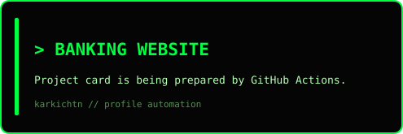
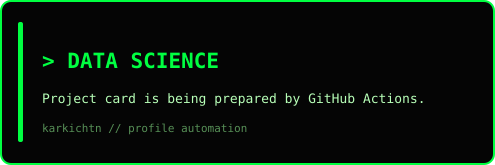

<div align="center">
  
  <br />
  
  <br />
  
</div>

---

## `> whoami`


Hey! I'm **Chetan Singh**, a Computer Science student specializing in **Artificial Intelligence and Machine Learning**.

I enjoy understanding how things work, solving problems with code, and turning ideas into useful projects. Right now, I'm strengthening my fundamentals in C++ and exploring software development, web technologies, and AI/ML.

```text
+--------------------------------------------------+
|  USER       : Chetan Singh                       |
|  FIELD      : Computer Science (AI & ML)         |
|  CURRENTLY  : DSA in C++                         |
|  INTERESTS  : Software Dev | Web | AI/ML         |
|  MINDSET    : Learn -> Build -> Improve          |
+--------------------------------------------------+
```

## `> tech_stack --list`

<p align="center">
  
</p>

## `> featured_projects`

<p align="center">
  <a href="https://github.com/karkichtn/portfolio-website">
    
  </a>
  <a href="https://github.com/karkichtn/Banking-Website">
    
  </a>
  <a href="https://github.com/karkichtn/DATA-SCIENCE">
    
  </a>
</p>

<p align="center">
  <sub>Project cards are generated and stored in this repository by GitHub Actions. If they are not visible yet, run <b>Generate Matrix Profile Cards</b> from the Actions tab.</sub>
</p>

## `> github_stats --show`

<p align="center">
  
  
</p>

<p align="center">
  

</p>

<sub>Stats and language cards are generated daily and stored in this repository. They use public GitHub data.</sub>

## `> contribution_snake --animate`

<p align="center">
  <picture>
    <source media="(prefers-color-scheme: dark)" srcset="https://raw.githubusercontent.com/karkichtn/karkichtn/output/github-contribution-grid-snake-dark.svg" />
    <source media="(prefers-color-scheme: light)" srcset="https://raw.githubusercontent.com/karkichtn/karkichtn/output/github-contribution-grid-snake.svg" />
    
  </picture>
</p>

## `> current_mission`

- Improve problem-solving and DSA fundamentals in **C++**.
- Build useful projects and write cleaner, more maintainable code.
- Keep exploring **AI/ML**, backend development, and Android development.

---

<div align="center">
  
  <br />
  <sub>Made with curiosity, coffee, and code.</sub>
</div>
